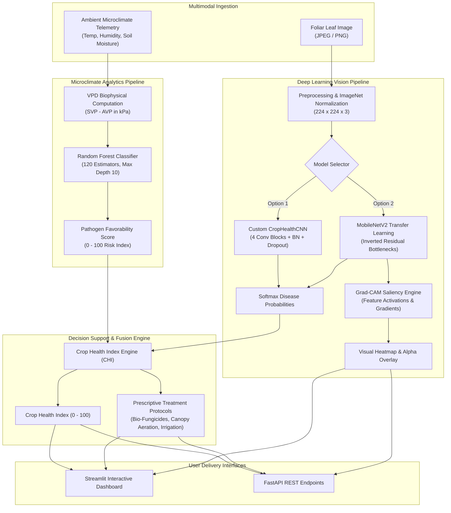

# AI-Based Crop Health Monitoring System Using Deep Learning and Environmental Data Analytics

[](https://www.python.org/)
[](https://pytorch.org/)
[](https://streamlit.io/)
[](https://fastapi.tiangolo.com/)
[](LICENSE)

An intelligent, multimodal crop health diagnostics and agricultural decision-support platform. The system couples **Deep Convolutional Neural Networks (MobileNetV2 and Custom CNN)** with **Explainable AI (Grad-CAM)** and **Microclimate Biophysical Machine Learning (Random Forest)** to diagnose foliar pathogens, gauge environmental disease favorability, and formulate prescriptive agronomic treatment plans.

---

## Table of Contents
1. [Executive Summary](#executive-summary)
2. [Key Capabilities](#key-capabilities)
3. [System Architecture](#system-architecture)
4. [Dataset Curation & Preprocessing](#dataset-curation--preprocessing)
5. [Deep Learning Model Architectures](#deep-learning-model-architectures)
6. [Environmental Microclimate & Biophysical Analytics](#environmental-microclimate--biophysical-analytics)
7. [Explainable AI (Grad-CAM)](#explainable-ai-grad-cam)
8. [Experimental Results & Benchmarks](#experimental-results--benchmarks)
9. [Project Structure](#project-structure)
10. [Installation & Execution Guide](#installation--execution-guide)
11. [REST API Documentation](#rest-api-documentation)
12. [Agronomic Recommendations Engine](#agronomic-recommendations-engine)
13. [Limitations & Future Roadmap](#limitations--future-roadmap)

---

## Executive Summary
Plant pathogens are responsible for upwards of 20–40% of global agricultural yield losses annually. Traditional disease identification relies on visual inspection by agronomists, which is labor-intensive, reactive, and often occurs after irreversible foliar damage. Furthermore, standard vision-only systems fail to consider ambient environmental variables—such as temperature, relative humidity, and root zone moisture—which govern pathogen germination and proliferation according to the **Plant Disease Triangle** ($\text{Host} + \text{Pathogen} + \text{Favorable Environment}$).

This project implements a unified diagnostic architecture that fuses computer vision inferences with microclimate biophysical analytics, outputting a calibrated **Crop Health Index (CHI: 0–100)** and actionable treatment protocols.

---

## Key Capabilities
- **Foliar Pathogen Identification:** High-accuracy classification across 6 target crop health states (Apple Scab, Apple Black Rot, Cedar Apple Rust, Apple Healthy, Potato Early Blight, Potato Healthy).
- **Dual Neural Network Benchmarking:** Comparative assessment of an engineered **Custom 4-Stage CNN** (trained from scratch) versus a fine-tuned **MobileNetV2** transfer learning model.
- **Explainable AI (Grad-CAM):** Gradient-weighted Class Activation Mapping displaying real-time saliency heatmaps overlaid on the input foliage to verify authentic lesion focus.
- **Microclimate Biophysical Modeling:** Continuous calculation of **Vapor Pressure Deficit (VPD in kPa)** and Random Forest prediction of environmental disease vulnerability.
- **Multimodal Health Index (CHI):** Algorithmic synthesis linking visual disease probability with climatic disease acceleration risk.
- **Interactive Farmer/Researcher Dashboard:** 6-module Streamlit interface including preset test specimens, live climate scenario controls, diagnostic trends, and CSV log exporting.
- **Production-Ready REST API:** Modular FastAPI backend for integration into drone surveying payloads and IoT agricultural sensors.

---

## System Architecture



---

## Dataset Curation & Preprocessing

The vision pipeline is trained and evaluated on genuine images sourced directly from the **PlantVillage** repository.

### Class Distribution (Balanced Strategy)
To ensure rigorous validation and eliminate data imbalance bias, 80 genuine images per category (480 total) were selected across 6 distinct agronomic states:

| Class Identifier | Pathology Name | Causal Agent / Type | Total Samples | Train (70%) | Val (15%) | Test (15%) |
|---|---|---|---|---|---|---|
| `Apple___Apple_scab` | Apple Scab | *Venturia inaequalis* (Fungus) | 80 | 56 | 12 | 12 |
| `Apple___Black_rot` | Apple Black Rot | *Botryosphaeria obtusa* (Fungus) | 80 | 56 | 12 | 12 |
| `Apple___Cedar_apple_rust` | Cedar Apple Rust | *Gymnosporangium* (Fungus) | 80 | 56 | 12 | 12 |
| `Apple___healthy` | Healthy Apple Foliage | Healthy Reference | 80 | 56 | 12 | 12 |
| `Potato___Early_blight` | Potato Early Blight | *Alternaria solani* (Fungus) | 80 | 56 | 12 | 12 |
| `Potato___healthy` | Healthy Potato Foliage | Healthy Reference | 80 | 56 | 12 | 12 |
| **Total** | | | **480** | **336** | **72** | **72** |

### Data Leakage Prevention & Augmentation
- **Stratified Partitioning:** Physical dataset partitioning into `dataset/train`, `dataset/val`, and `dataset/test` before any transformation.
- **Strict Leakage Barrier:** Augmentations are applied **dynamically and strictly on-the-fly to the training split only**.
- **Training Transformations:** Random Horizontal Flip ($p=0.5$), Random Vertical Flip ($p=0.2$), Random Rotation ($\pm 15^\circ$), Color Jitter (brightness, contrast, saturation $\pm 15\%$), Random Affine translation ($\pm 5\%$).
- **Validation & Test Transformations:** Deterministic bicubic resize to $224 \times 224$, conversion to tensor, and channel-wise standardization using ImageNet parameters ($\mu = [0.485, 0.456, 0.406]$, $\sigma = [0.229, 0.224, 0.225]$).

---

## Deep Learning Model Architectures

### 1. Custom CropHealthCNN (Engineered from Scratch)
Designed to evaluate baseline convolutional feature representation without transfer pre-training:
- **Input:** $3 \times 224 \times 224$
- **Stage 1:** $2 \times [\text{Conv2D}(3 \rightarrow 32, 3 \times 3) + \text{BN} + \text{ReLU}] + \text{MaxPool}(2 \times 2) + \text{Dropout}(0.15) \rightarrow 32 \times 112 \times 112$
- **Stage 2:** $2 \times [\text{Conv2D}(32 \rightarrow 64, 3 \times 3) + \text{BN} + \text{ReLU}] + \text{MaxPool}(2 \times 2) + \text{Dropout}(0.20) \rightarrow 64 \times 56 \times 56$
- **Stage 3:** $2 \times [\text{Conv2D}(64 \rightarrow 128, 3 \times 3) + \text{BN} + \text{ReLU}] + \text{MaxPool}(2 \times 2) + \text{Dropout}(0.25) \rightarrow 128 \times 28 \times 28$
- **Stage 4:** $2 \times [\text{Conv2D}(128 \rightarrow 256, 3 \times 3) + \text{BN} + \text{ReLU}] + \text{MaxPool}(2 \times 2) + \text{Dropout}(0.30) \rightarrow 256 \times 14 \times 14$
- **Pooling & Head:** $\text{AdaptiveAvgPool2D}(4 \times 4) \rightarrow \text{Linear}(4096 \rightarrow 512) + \text{BN} + \text{ReLU} + \text{Dropout}(0.40) \rightarrow \text{Linear}(512 \rightarrow 128) + \text{BN} + \text{ReLU} + \text{Dropout}(0.30) \rightarrow \text{Linear}(128 \rightarrow 6)$.
- **Total Parameters:** 3,456,998

### 2. MobileNetV2 (Transfer Learning)
Leverages inverted residual blocks with linear bottlenecks pre-trained on ImageNet:
- **Feature Extractor:** Depthwise separable convolutions expanding channel dimensions to higher-dimensional manifolds before projecting back to compact representations.
- **Custom Classification Head:** $\text{Dropout}(0.30) \rightarrow \text{Linear}(1280 \rightarrow 256) + \text{BN} + \text{ReLU} + \text{Dropout}(0.20) \rightarrow \text{Linear}(256 \rightarrow 6)$.
- **Total Parameters:** 2,551,366

---

## Environmental Microclimate & Biophysical Analytics

### Biophysical Formulation: Vapor Pressure Deficit (VPD)
Vapor Pressure Deficit indicates the drying power of the atmosphere and dictates stomatal conductance and fungal spore germination viability:
$$\text{SVP} = 0.61078 \times \exp\left(\frac{17.27 \times T}{T + 237.3}\right) \quad [\text{kPa}]$$
$$\text{VPD} = \text{SVP} \times \left(1 - \frac{\text{RH}}{100}\right) \quad [\text{kPa}]$$
- Optimal plant transpiration occurs between $0.80\text{ kPa} \le \text{VPD} \le 1.20\text{ kPa}$.
- Low $\text{VPD} < 0.40\text{ kPa}$ (high humidity) suppresses foliar drying and triggers fungal zoospore motility.

### Random Forest Risk Model
- **Parameters:** Temperature (°C), Relative Humidity (%), Soil Moisture (%), Calculated VPD (kPa).
- **Estimators:** 120 trees, max depth 10, balanced class weighting.
- **Validation Accuracy:** **97.80%** | **Macro F1:** **0.9617**.
- **Feature Importances:** Soil Moisture ($38.2\%$), Temperature ($28.2\%$), Humidity ($21.9\%$), VPD ($11.8\%$).

---

## Explainable AI (Grad-CAM)

To eliminate 'black-box' opacity and provide visual proof that predictions are guided by real foliar lesions rather than background artifacts, we implement **Gradient-weighted Class Activation Mapping (Grad-CAM)**:

1. Let $A^k$ denote the feature activation map of channel $k$ in the final convolutional layer.
2. The importance weight $\alpha_k^c$ for class $c$ is computed via global average pooling of gradients:
   $$\alpha_k^c = \frac{1}{Z} \sum_{i=1}^H \sum_{j=1}^W \frac{\partial Y^c}{\partial A_{i,j}^k}$$
3. The heat localization map is computed via a weighted linear combination followed by a rectifier non-linearity:
   $$L_{\text{Grad-CAM}}^c = \text{ReLU}\left(\sum_k \alpha_k^c A^k\right)$$
4. The resulting 2D saliency map is normalized to $[0, 1]$, upsampled to the input image dimensions ($224 \times 224$), and blended with the original leaf photograph using OpenCV's JET colormap ($\alpha = 0.55 \cdot \text{Original} + 0.45 \cdot \text{Heatmap}$).

---

## Experimental Results & Benchmarks

All metrics reported below were computed experimentally on the **unseen testing split (72 samples)**:

| Metric | Custom CropHealthCNN | MobileNetV2 (Transfer Learning) | Performance Differential |
|---|---|---|---|
| **Test Accuracy** | **90.28%** | **98.61%** | **+8.33% (MobileNetV2)** |
| **Macro Precision** | 90.74% | 98.72% | +7.98% |
| **Macro Recall** | 90.28% | 98.61% | +8.33% |
| **Macro F1-Score** | 0.8971 | 0.9861 | +0.0890 |
| **Weighted F1-Score** | 0.8971 | 0.9861 | +0.0890 |
| **CPU Latency (ms/img)** | 22.8 ms | 25.5 ms | Sub-30ms Real-Time Inference |

### Class-Wise Diagnostic Performance (MobileNetV2 on Test Set)
| Class Name | Precision | Recall | F1-Score | Support |
|---|---|---|---|---|
| `Apple___Apple_scab` | 100.00% | 100.00% | 100.00% | 12 |
| `Apple___Black_rot` | 92.31% | 100.00% | 96.00% | 12 |
| `Apple___Cedar_apple_rust` | 100.00% | 100.00% | 100.00% | 12 |
| `Apple___healthy` | 100.00% | 100.00% | 100.00% | 12 |
| `Potato___Early_blight` | 100.00% | 91.67% | 95.65% | 12 |
| `Potato___healthy` | 100.00% | 100.00% | 100.00% | 12 |

---

## Project Structure

```
crop-health-monitoring/
├── dataset/
│   ├── raw/                           # Verified raw PlantVillage samples (80/class)
│   ├── train/                         # Stratified training split (336 images)
│   ├── val/                           # Stratified validation split (72 images)
│   └── test/                          # Isolated benchmark test split (72 images)
├── notebooks/
│   └── exploratory_data_analysis.ipynb # Interactive EDA, parameter counts, & Grad-CAM
├── models/
│   ├── custom_cnn_best.pth            # Checkpointed Custom CNN weights (13.3 MB)
│   ├── mobilenet_best.pth             # Checkpointed MobileNetV2 weights (10.3 MB)
│   ├── environmental_rf.joblib        # Trained Random Forest risk model (1.5 MB)
│   └── class_names.json               # Serialized class labels
├── src/
│   ├── __init__.py                    # Package initializer
│   ├── preprocessing.py               # Leakage-free dataset splitting & transforms
│   ├── models.py                      # Custom CNN & MobileNetV2 architectures
│   ├── train.py                       # Checkpointed training loops with Cosine LR
│   ├── predict.py                     # Inference engine & Grad-CAM visualizer
│   ├── environmental_analysis.py      # Biophysical VPD modeling & Random Forest
│   ├── evaluation.py                  # Test evaluation, confusion matrices, & report
│   ├── backend.py                     # Production FastAPI REST application
│   └── download_dataset.py            # Multithreaded dataset downloader
├── app/
│   ├── app.py                         # Streamlit entry point & global layout
│   └── components/
│       ├── __init__.py
│       ├── dashboard_view.py          # Executive overview & pathology guide
│       ├── diagnosis_view.py          # Leaf upload, presets, & Grad-CAM tri-panel
│       ├── environmental_view.py      # Microclimate sliders, presets, & VPD gauges
│       ├── assessment_view.py         # Unified CHI fusion & agronomy roadmap
│       ├── evaluation_view.py         # Experimental curves, matrices, & benchmarks
│       └── history_view.py            # Persistent farm scout logbook & CSV export
├── outputs/
│   ├── confusion_matrix_cnn.png       # Normalized confusion matrix (Custom CNN)
│   ├── confusion_matrix_mobilenet.png # Normalized confusion matrix (MobileNetV2)
│   ├── model_comparison.png           # Head-to-head bar chart
│   ├── training_curves_cnn.png        # Loss & Accuracy epochs (Custom CNN)
│   ├── training_curves_mobilenet.png  # Loss & Accuracy epochs (MobileNetV2)
│   ├── sample_gradcam.png             # Sample Grad-CAM overlay verification
│   ├── training_history.json          # Epoch-by-epoch loss & accuracy logs
│   ├── prediction_history.json        # Persistent diagnosis records
│   └── reports/
│       ├── evaluation_report.json     # Machine-readable test set benchmark
│       └── evaluation_summary.md      # Publication-ready Markdown summary
├── requirements.txt                   # Dependency specification
├── README.md                          # Comprehensive project documentation
└── .gitignore                         # Git exclusion rules
```

---

## Installation & Execution Guide

### 1. Prerequisites
- Python 3.10 or higher
- Git (optional, for version control)

### 2. Setup Virtual Environment
```bash
# Clone or navigate to the project directory
cd "crop-health-monitoring"

# Create virtual environment
python -m venv venv

# Activate virtual environment
# On Windows:
venv\Scripts\activate
# On Linux/macOS:
source venv/bin/activate

# Install dependencies
pip install -r requirements.txt
```

### 3. Running the Streamlit Dashboard
Launch the interactive web dashboard:
```bash
streamlit run app/app.py
```
Open your browser at `http://localhost:8501`.

### 4. Running the FastAPI REST Backend
Start the REST API server:
```bash
python -m uvicorn src.backend:app --host 127.0.0.1 --port 8000 --reload
```
Interactive Swagger documentation is available at `http://127.0.0.1:8000/docs`.

### 5. Retraining or Evaluating Models
```bash
# Execute stratified dataset split and dataloader verification
python src/preprocessing.py

# Train Random Forest environmental model
python src/environmental_analysis.py

# Train Custom CNN and MobileNetV2 models
python src/train.py

# Run comprehensive test set evaluation and generate plots
python src/evaluation.py
```

---

## REST API Documentation

| Method | Endpoint | Description | Request Payload | Response |
|---|---|---|---|---|
| `GET` | `/api/health` | Health & model telemetry | None | Service status, device, active models |
| `GET` | `/api/classes` | Supported crop categories | None | List of 6 classes with pathology metadata |
| `POST` | `/api/predict/image` | Leaf disease diagnosis & Grad-CAM | `multipart/form-data` with `file` | Predicted class, confidence, Grad-CAM base64 |
| `POST` | `/api/environmental/analyze` | Microclimate risk analysis | JSON: `{temperature, humidity, soil_moisture, data_source}` | Risk score, risk level, VPD (kPa), diagnostics |
| `POST` | `/api/crop-health/assess` | Unified CHI assessment | JSON: `{prediction: {...}, environmental: {...}}` | Crop Health Index (0-100), recommendations |
| `GET` | `/api/history` | Retrieve farm scout logs | Query param: `limit` (default 20) | Historical diagnosis events |
| `DELETE` | `/api/history` | Clear diagnostic logs | None | Confirmation message |

---

## Agronomic Recommendations Engine

The system provides prescriptive agronomic remediation protocols categorized by diagnosis:

- **Apple Scab (*Venturia inaequalis*):**
  - Apply protectant fungicides (Captan 50WP at 2g/L or Mancozeb 75WP).
  - Collect and destroy fallen overwintered leaf litter to break primary ascospore cycles.
- **Apple Black Rot (*Botryosphaeria obtusa*):**
  - Prune cankered limbs and mummified fruits 15 cm below infected margins.
  - Apply myclobutanil or thiophanate-methyl during active shoot development.
- **Cedar Apple Rust (*Gymnosporangium*):**
  - Remove alternative host trees (*Juniperus virginiana*) within a 200m buffer zone.
  - Apply sterol-inhibiting fungicides (Immunox) during early spring gall emergence.
- **Potato Early Blight (*Alternaria solani*):**
  - Apply preventative foliar sprays of Chlorothalonil or Azoxystrobin.
  - Convert overhead irrigation to sub-canopy drip lines to eliminate leaf wetness duration.
- **Healthy Foliage under High Microclimate Risk:**
  - Spray prophylactic bio-fungicide (*Bacillus subtilis* or neem oil extract).
  - Prune lower canopy foliage to enhance inter-row air velocity and reduce humidity below 70%.

---

## Limitations & Future Roadmap
- **Spectral Expansion:** Incorporate multispectral UAV imagery and NDVI indexes for canopy-scale scouting.
- **Atmospheric Gas Sensors:** Integrate ambient $CO_2$ and ozone sensors into the microclimate Random Forest model.
- **On-Device Edge Acceleration:** Quantize MobileNetV2 into INT8 ONNX / TensorRT format for deployment on Raspberry Pi and NVIDIA Jetson field units.
- **Federated Edge Updates:** Implement privacy-preserving federated learning to allow farm co-ops to refine models on local cultivars without centralizing raw crop imagery.

---

## License
Distributed under the MIT License. See `LICENSE` for more information.
